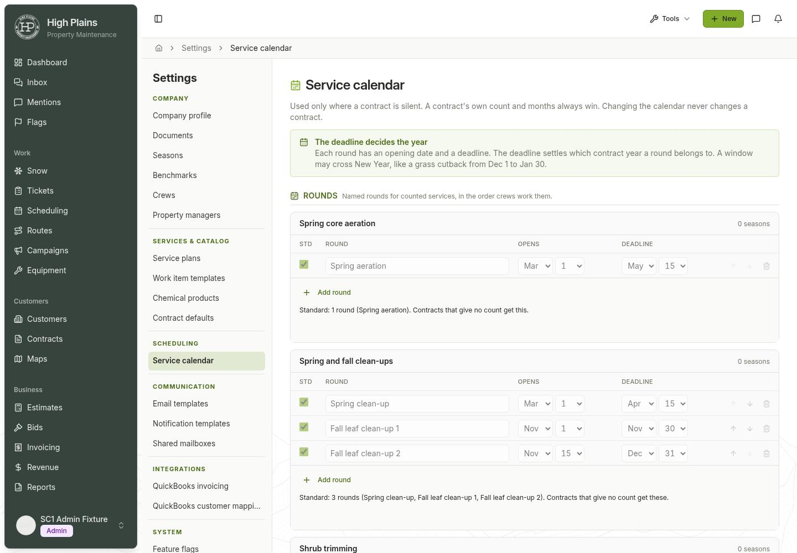
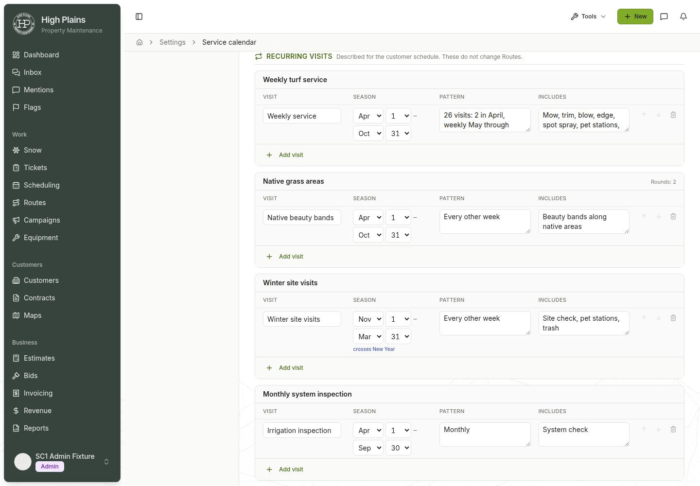

# SC1 — Service calendar verification

Date: 2026-11-11. Environment: isolated task checkout and **development database only**.

## Delivered scope and safety boundary

Implemented the assigned task and uploaded SC1 brief, with the two explicit
owner clarifications taking precedence:

1. Every compatible kind may coexist for one service. Native areas has two
   full-mow rounds and one recurring beauty-bands entry. Position 1 can repeat
   across kinds, never within a kind.
2. After retirement, existing demand, reconcile, round contract-state projection
   and customer fulfillment receive empty program lists. Calendar allocation,
   deadline-based contract-year assignment and the customer schedule belong to
   SC2/SC3, not SC1.

Contract values and Routes were not edited. Existing contract-stated chemical
months remain honored; chemical is hidden only from new scope selection.
Split stages changes in the editor, never writes by itself and does not
automatically rewrite renewal sources. No production database operation,
starting-calendar load, Generate run, backfill, deployment or publication was
performed. Generation/reconciliation tests operated only on disposable fixtures.

## Predecessors and caller inventory

Read the actual catalog, Campaigns ledger and implemented CG2/CG3/CG4/CG5/CP6
producers and consumers, rather than treating removed numbered specifications
as gates. Existing contract coverage, monthly demand allocation, company
generation gate and recorded-work protection logic were retained.

| Former program caller or owner | SC1 disposition |
|---|---|
| API `services/servicePrograms.ts`, `routes/servicePrograms.ts` and their tests | Removed; new calendar services/routes and focused tests replace them |
| `routes/routes.ts` registration | `registerServiceCalendarRoutes` only |
| Both schema declarations `servicePrograms` / `ServiceProgram` | Removed; `serviceCalendar` / `ServiceCalendar` replace the owner |
| `lib/db/src/serviceProgramContracts.ts`, `serviceProgramCheckSql` | Removed; eligibility/usage moved to calendar contracts; no former persistence DTO remains |
| `campaignReconcile` | Calls unchanged monthly engine with `programs: []`; no old-table query or calendar timing read |
| `campaignContractState` | Same empty-input projection, preserving explicit legacy contract months |
| `customerServiceFulfillmentLoader` | Eight batched company-scoped reads with dated terms, seven otherwise; `programs: []` |
| `campaignDemand` / `customerServiceFulfillment` | Browser-safe eligibility import updated; `DemandTimingProgram` remains only a pure-engine transitional input, not a table/type owner |
| `campaignMembership` middleware | No retired-program route; calendar writes do not trigger calendar-based reconciliation |
| Predecessor database tests | Persist contract-stated months instead of querying or seeding the retired owner |
| CRM Service timing page/tests and rail item | Replaced with Service calendar; old URL redirects, preserving query strings |
| Generate/customer Services gap links | Point to the new settings route; no customer scheduling algorithm was changed |
| Ownership map | One company calendar owner, distinct from contract facts and operational Routes |

A final source search found no live `servicePrograms`, `ServiceProgram`,
`serviceProgramContracts` or `/api/service-programs` references in API/CRM/DB
source. `service_programs` appears only in the new migration refusal test.
Historical migrations, reports and handoffs are deliberately retained.

## Migration and integrity

Migration: **`.migration-backup/migrations/0080_service_calendar.sql`**.
The prefix was unused after 0079 when selected. The final sync also integrated
main's independently applied `0080_publish_check_compatibility.sql` and
`0081_service_calendar_publish_check.sql`. The already-applied SC1 filename was
preserved despite the concurrent duplicate numeric prefix, consistent with the
project's migration-filename stability rule. No applied SQL file was renamed
or rewritten to resolve numbering.

- Development preflight `SELECT count(*) FROM service_programs` returned **0**.
- `pnpm --filter @workspace/scripts run migrate` applied exactly the new
  migration: **1 applied, 92 already up-to-date**. Existing 0074 checksum warning
  was reported and not repaired, bypassed or reapplied.
- The first executable migration block locks the old table before checking
  emptiness. A populated table raises an explicit refusal; nothing is converted
  or deleted. A real PostgreSQL transaction-local populated-table test executes
  that exact guard (only its catalog lookup changes to the temporary schema),
  asserts the refusal message and verifies its row remains after rollback.
- `service_calendar` has the exact SC1 columns and company/user deletion
  behavior. `opens_md` / `due_md` are `char(5)` in SQL and both schema mirrors.
- SQL/shared validation reject impossible month/day values and February 29,
  equal endpoints, empty/overlong names, invalid positions, incompatible
  kind/service pairs, non-round standards and non-recurring pattern/includes.
  Names are trimmed on shared input; stored names must already be trimmed.
- Distinct days on the non-leap cycle give windows of 1–364 elapsed days
  (at most **365 days inclusive**), including New Year crossings.
- One checklist per service is enforced independently. Position uniqueness is
  `(company_id, service_key, kind, position)`; SQL makes the key deferrable so
  stable-ID swaps do not require invalid temporary positions or delete/reinsert.
  The API sets it deferred only during a replacement and validates it before
  returning. Drizzle declares the same key/columns/checks; deferrability itself
  is SQL-migration-owned because the Drizzle unique builder cannot express it.
- Final sync preserved main's Publish-introspection compatibility fix:
  `serviceCalendarCheckSql` wraps its existing boolean rule in **`IS TRUE`**,
  matching main's constraint-only 0081 migration without weakening NULL
  rejection. The retired `serviceProgramCheckSql` was not resurrected.
  The independent Publish evidence remains in
  `publish-check-constraints-verification.md`; this task did not repeat any
  production or Publish operation.
- `campaigns_identity_check` accepts the expanded campaign set **and historical
  generated chemical** identities, retaining category/subtype requirements.
- Schema drift and required-extension commands both passed. `pg_trgm` remains
  present; no extension or unrelated schema change was introduced.

## API verification

Endpoints:

- `GET /api/service-calendar` → `{ entries, usage }`.
- `PUT /api/service-calendar/:serviceKey` →
  `{ entries: CalendarEntryInput[], allowEmptyStandard?: boolean }`, returning
  the full calendar and usage.
- `POST /api/service-calendar/load-starting` → full calendar, **409** if nonempty.

Session authentication, effective access-role allow-lists, super-admin override,
active company, initiating `X-Company-Id`, `Cache-Control: no-store` and
server-owned updater behavior match the former API.

Replacement runs transactionally under
`pg_advisory_xact_lock(hashtextextended('service-calendar:' || companyId || ':' || serviceKey,0))`.
Existing IDs update in place; new rows insert and omitted rows delete.
Foreign, wrong-service, stale, repeated or changed-kind IDs are rejected.
An additional shared company gate for replacements/exclusive gate for load
prevents empty-load races across different services.

Tests cover mixed native kinds/repeated cross-kind positions, in-place swaps,
stable IDs, insertion/deletion, invalid kinds, company/role/header/identity
guards, all-or-nothing rollback after a later FK failure, concurrent replacements,
load-vs-load and load-vs-replacement serialization, and explicit standard removal
even when the final round list is empty.

Usage tests cover distinct eligible included seasons, the exact five statuses,
ended/other-company/excluded-season filtering, count and missing-month groups,
blank counts, zero, invalid counts/months, duplicates, linked needs-rounds,
standard-vs-total count distinction, checklist usage and distinct linked
legacy chemical seasons only when neither new treatment line is present.

The transition integration test loads real calendar rows and verifies both
preview and reconcile still return **`no_timing` / `no_count` gaps** instead of
using the new calendar. Customer fulfillment exposes the same gaps. Stated
contract months still produce their original monthly demand and stay unchanged.

## Frontend verification

`ServiceCalendarPage` reuses `SettingsRailLayout`, the existing unsaved-link,
history/unload protections and company/role-change remount convention.
Focused section components live under `pages/service-calendar/`.

Verified with rendered tests:

- Rounds, checklist, recurring and read-only on-request sections.
- Per-service draft/Save/Discard, including native sections sharing one draft
  and one full-service replacement.
- Positions restart within each kind and stable IDs survive edits/order changes.
- Standard text follows checkboxes. Unticking all standards or deleting the
  final rounds requires warning confirmation and explicit authorization.
- Office has no write controls. Calendar query keys include company/viewer/role;
  requests retain the initiating company header.
- Dirty navigation/history guards and company-switch draft discard/notice.
- Empty panel previews all **23 entries** and loads only on an admin click.
- Failed/malformed responses retain drafts and report an error. Fields for a
  service are disabled while its save is pending, including its other section.
- Old URL redirect, query-string preservation and updated rail/gap links.
- Legacy chemical is hidden for new scope, visible on existing lines, and Split
  stages fertilization with the old quantity and broadleaf with blank quantity
  without any persistence before the normal explicit Save.
- English and Spanish calendar guidance, controls and month names.

## Commands and results

Evidence logs are retained locally under ignored `generated-artifacts/sc1/`;
they are generated outputs, not committed assets.

| Check | Result |
|---|---|
| New calendar shared/API/database suites | **42 passed**, plus **7 catalog checks**, after final main sync: **49 passed** across 3 files (`post-sync-tests.log`) |
| Catalog, demand, fulfillment/loader, membership unit/integration and generation suites | Passing relevant cases across the focused runs; see transient note below |
| Existing CG4 round-list/access/completion integration suite | **25 passed**, run alongside the calendar integration suite |
| Existing CG2 generation/rollback/identity/protected-work suite | **27 passed** standalone (`cg2-recheck.log`) |
| Calendar/Split/navigation/customer-service rendered tests | **49 passed** across 4 files, artifact-local Vitest |
| Existing contract create/save/New Contract/Contract Center regressions | **55 passed** across 4 files (`crm-predecessor-tests.log`) |
| Existing Generate page rendered regressions | **8 passed**; transitional explanation correctly says calendar allocation is not active yet (`generate-ui-final.log`) |
| `pnpm run typecheck:libs` | Passed before and after shared declarations |
| API leaf typecheck | **695 existing diagnostics before / 695 after** |
| CRM leaf typecheck | **212 existing diagnostics before / 212 after** |
| `check-schema-drift` | Passed |
| `check-required-extensions` | Passed |
| `git diff --check` | Passed |
| Managed API/CRM startup | Both serving; health **200**, signed-out calendar **401**, transformed calendar module **200** |

Typechecks remain failing at their existing broad baselines. No compiler flags,
exclusions or test assertions were weakened. API diagnostic file/line/code
multisets match exactly after mapping locations through the source diff. Four
unchanged legacy `ZodError.errors` descriptions print inferred properties in a
different order; their locations/codes and failure meaning are unchanged. CRM
diagnostic messages and counts match without semantic additions.

An intermediate combined database run encountered a company-cleanup deadlock
in an existing CG2 fixture, then a duplicate fixture ID following that failed
cleanup. Its isolated unchanged recheck passed all 27 tests. This was recorded,
not hidden with retries in the tests. The existing development QuickBooks
fixture-token warnings, PostgreSQL SSL-mode warning and Vite Browserslist/
PostCSS warnings remain outside SC1; no new calendar startup error was seen.

After resolving the final main sync, the strict migration runner reported
**0 applied / 95 already up-to-date** (only the unchanged historical 0074
checksum warning). Calendar/shared/PostgreSQL/catalog checks passed **49/49**,
including the Publish-safe wrapper regression. The API was rebuilt/restarted
against the merged source. This sync did not change the verified browser flows.

Reproducible focused commands:

```sh
pnpm --filter @workspace/api-server exec vitest run \
  src/services/serviceCalendar.test.ts src/routes/serviceCalendar.integration.test.ts \
  --maxWorkers=1 --no-file-parallelism
pnpm --filter @workspace/api-server exec vitest run \
  src/shared/contractCatalog.test.ts src/lib/campaignDemand.test.ts \
  src/lib/customerServiceFulfillment.test.ts src/lib/customerServiceFulfillmentLoader.test.ts \
  src/lib/campaignMembership.test.ts src/lib/campaignMembership.integration.test.ts \
  src/routes/campaignGeneration.integration.test.ts src/lib/campaignRoundLists.integration.test.ts \
  --maxWorkers=1 --no-file-parallelism
pnpm --filter @workspace/highplains-crm exec vitest run \
  src/pages/ServiceCalendar.rendered.test.tsx src/components/contracts/ScopeEditor.split.test.tsx \
  src/components/nav/settingsNav.test.ts src/components/customer/pages/ServicesPage.cp2.test.tsx
```

## Browser evidence and screenshot

One signed-in journey used a disposable development company/admin/office,
not real-company or production data:

1. Admin followed the old URL and reached the new calendar route. The empty
   preview displayed **18 rounds + 1 checklist + 4 recurring visits**.
2. Clicking Load sent **POST 200**; subsequent **GET 200** contained exactly
   **23 entries**.
3. Admin edited a native round name and the beauty-bands pattern, moved the
   spring round down and back up, then used **one recurring-section Save**.
   Exactly **one PUT 200** carried all three native entries: round positions
   **1/2** and recurring position **1**, with their original stable IDs.
   **GET 200 and browser reload** both retained the changes and ordering.
4. The original three native rows were restored and verified after reload.
   Sending unfiltered GET objects first returned **400** because `serviceKey`
   and `updatedAt` are server-owned. Omitting those fields returned **200**,
   confirming strict input rather than a client-supplied identity upsert.
5. Office signed in and saw **Read-only**, all **18 checkboxes disabled**, and
   **no buttons within the calendar component** (no Save, Add or Load).
6. No retired-program calls or contract-edit calls occurred during the journey.

The tester's interaction checks passed. Its overall result was marked unable
only because its screenshot attachments were not exposed as filesystem files.
To meet the retained-evidence requirement, a separate **static** authenticated
Chromium capture of the restored development page saved the two compact JPEGs
below; this did not repeat the browser journey or mutate calendar data.
The screenshots were inspected. The disposable company and both users were
then deleted; no fixture calendar remains in real-company data.

### Loaded starting calendar — header and rounds



### Recurring visits — native beauty bands and cross-year winter visits



Additional interactive screenshot references in the task conversation:
`82y7d4` (empty preview), `wcfjys` (native save), `h980tt` (restored admin),
`kkacte` (recurring section), `3yiunk` (office read-only).

## Deviations, limitations and handoff

- The named **“Service Calendar Mockups” / “Settings › Service timing
  (reworked)”** artboard was unavailable in the checkout's sandbox source and
  available canvas. The implementation follows section 5 of the uploaded brief
  and existing CRM rail/layout/tokens. **No pixel match to that absent artboard
  is claimed.**
- The typed starting constant also supplies the required empty-company preview,
  intentionally avoiding a second inconsistent set of starting rows. It is not
  read by demand, reconcile or fulfillment.
- Until SC2, changing calendar standards/windows does not repair Generate's
  program-dependent gaps. No catalog defaults, inferred months or calendar
  allocation were added as a fallback.
- No production validation or starting-calendar load is claimed. The migration's
  zero-row condition must remain a safety boundary; populated old timing is not
  permission to delete or convert it.
- SC2 and SC3 are explicitly not started. Stable calendar IDs and full-service,
  mixed-kind replacement are ready for their later authorized integration.
